**Desenvolvedor Full Stack | Fundador da [Lottus Labs](https://lottus-labs.com.br)**

##

  

 

  

##

### 👨‍💻 Sobre mim

Sou **Guilherme Pereira**, desenvolvedor Full Stack e **fundador da [Lottus Labs](https://lottus-labs.com.br)**, empresa voltada ao desenvolvimento de soluções tecnológicas.

Sou graduado em **Análise e Desenvolvimento de Sistemas pela Fatec** e atuo profissionalmente como desenvolvedor desde o final de 2024, tendo iniciado meus estudos em programação em 2023.

Minha experiência envolve o desenvolvimento de aplicações de ponta a ponta, desde arquitetura de software, modelagem de dados e construção de APIs até interfaces, integrações externas, automações, infraestrutura e implantação em produção.

Tenho foco especial em **soluções que resolvem problemas reais**, automatizam processos e geram resultados mensuráveis para empresas e instituições.

<h3>🚀 Projetos de destaque</h3>

 

#### 🚗 Plataforma de Gestão e Automação de Infrações de Velocidade

**Sistema Multi-Tenant | Produção Comercial | Desenvolvimento Individual**

Desenvolvi individualmente uma plataforma utilizada diariamente por **mais de 14 condomínios**, responsável por automatizar integralmente o processamento de infrações de velocidade registradas por radares internos.

A solução inclui:

- **Gateway de radares** que só confirma o evento depois de gravá-lo em disco, com deduplicação e limite de 60 eventos novos por minuto por equipamento.
- **Filas persistentes** para entrada, fotos e notificações, com checkpoints por etapa e retomada após reinício, sem perder evento nem duplicar infração.
- **Regras por condomínio**, com reincidência e multa por ocorrência, e identificação automática do responsável pela placa.
- **Anonimização de imagens com Inteligência Artificial** (YOLOv8 e OpenCV), preservando a placa e a tarja de dados como prova.
- **Notificações automatizadas** por e-mail e WhatsApp, com o documento em PDF.
- **Alertas no WhatsApp** de falta de comunicação dos radares, aferição e saldo da API de placas.
- **Dashboards em tempo real**, relatórios gerenciais, exportação de dados e trilha de auditoria.
- **Desempenho**: auditoria com milhões de registros otimizada com coluna virtual e índice composto no MySQL, aplicados sem travar a tabela.
- **Arquitetura multi-tenant**, permitindo múltiplos clientes em uma única aplicação e banco de dados, com isolamento lógico de dados.
- **Docker, infraestrutura em nuvem e CI/CD**, garantindo padronização dos deploys e facilitando manutenção e expansão.

**📊 Impacto gerado:**

| Indicador | Resultado |
|:---|:---|
| Clientes atendidos | 14+ condomínios |
| Volume processado | Cerca de 70 mil infrações por mês |
| Processamento anterior | Cerca de 15 minutos por notificação |
| Processamento automatizado | Aproximadamente 5 segundos |
| Automação do processo | 100% |
| Ganho operacional | Dezenas de horas economizadas mensalmente |

A implementação eliminou tarefas manuais repetitivas, reduziu falhas operacionais e removeu a necessidade de contratação de um funcionário dedicado exclusivamente a essa atividade.

Além disso, a arquitetura possibilitou expandir a operação sem necessidade de crescimento proporcional da equipe ou dos custos de infraestrutura, aumentando a eficiência, a capacidade de atendimento e o potencial comercial do negócio.

Todo o ciclo de desenvolvimento, incluindo **arquitetura, backend, frontend, integrações, banco de dados, infraestrutura e deploy**, foi realizado individualmente por mim.

🔗 Saiba mais sobre o projeto: [Rumo Radares - GitHub](https://github.com/GuilhermeFranciscoPereira/RumoRadares_Pinguim)

---

#### 🛡️ IntegraSig — Canal de Denúncias e Gestão da NR-1

**SaaS Multi-Tenant | White-label | Produção Comercial | Desenvolvimento Individual**

Desenvolvi individualmente o IntegraSig, um SaaS de canal de denúncias e gestão da NR-1 em produção, em conformidade com a **Lei 14.457/2022**, a **NR-1** e a **LGPD**.

A solução inclui:

- **Canal exclusivo por empresa**, com relatos sem identificação por link ou QR Code, protocolo e código de acompanhamento guardado apenas como hash.
- **White-label completo**: logo, cores, fonte, textos e termos de cada empresa cliente.
- **Módulo NR-1** com questionário psicossocial de 50 perguntas e resultados agregados, omitindo grupos com menos de 5 respostas.
- **Financeiro com Mercado Pago** (Pix, boleto e cartão), webhooks assinados, faturas, notas fiscais e bloqueio automático por inadimplência.
- **Segurança**: cookies httpOnly, refresh token rotativo, CSRF, isolamento por empresa e anexos privados com validação de assinatura.
- **Deploy contínuo** com Docker e GitHub Actions, com backups criptografados e teste de restauração.

🔗 Saiba mais sobre o projeto: [IntegraSig - GitHub](https://github.com/GuilhermeFranciscoPereira/Integra_Sig)

---

#### 🎓 Plataforma de Gestão de Eventos Acadêmicos — Fatec Itu

**Sistema Institucional | Produção Real | Desenvolvimento Individual**

Outro projeto que desenvolvi individualmente foi uma plataforma de gestão de eventos acadêmicos, inicialmente criada como meu **Trabalho de Conclusão de Curso (TCC)**.

O projeto ultrapassou o ambiente acadêmico: a solução foi **solicitada, aprovada e adotada oficialmente pela Fatec Itu**, tornando-se um sistema utilizado por alunos e colaboradores da instituição.

A plataforma digitaliza e centraliza processos relacionados à organização e ao gerenciamento de eventos acadêmicos.

Esse projeto representa a evolução de uma solução acadêmica para um **software institucional em produção**, desenvolvido para atender necessidades reais de uma instituição pública de ensino superior.

Fui responsável pelo desenvolvimento integral do **Front-end e Back-end** da plataforma. Porém, a versão **mobile** foi desenvolvida pelo meu grande amigo e desenvolvedor **[José Lucas](https://github.com/JoseMGomes)**, cujo trabalho está disponível no repositório: **[App Eventos Fatec - GitHub](https://github.com/JoseMGomes/app-eventos-fatec)**.

🔗 Saiba mais sobre o projeto: [Eventos Fatec Itu - GitHub](https://github.com/GuilhermeFranciscoPereira/Eventos_Fatec_Itu-Back-End)

---

#### 🧠 Lottus Brain — Segundo Cérebro da Lottus Labs

**Uso Interno | Produção | Desenvolvimento Individual**

Desenvolvi individualmente o Lottus Brain, o segundo cérebro da Lottus Labs: uma fonte única com tudo o que a empresa sabe, decide e faz, do comercial e dos clientes ao marketing, financeiro, jurídico e projetos, lida pela equipe no painel e usada como memória pela IA.

A solução inclui:

- **Conteúdo como código**: cada página é um Markdown com propriedades padronizadas, versionado no GitHub e validado antes de cada envio e de novo no CI.
- **Painel em Next.js e Supabase**, com busca, editor com prévia ao vivo, backlinks, grafo em 9 formatos com Galáxia 3D carregada sob demanda, funil de clientes, tarefas, Google Agenda e métricas semanais.
- **Saúde do cérebro**, que aponta links quebrados, propriedades com erro e páginas que ninguém cita.
- **Desempenho**: o conteúdo vem num único download em cache, e o painel é avisado na hora quando algo muda no GitHub.
- **Assistente com a API da Anthropic**, com tool use, streaming e prompt caching, somente leitura e com conversas privadas sincronizadas entre aparelhos.
- **Arquitetura de orquestração de agentes por setor**, com orquestrador, memória compartilhada no cérebro, skills reutilizáveis e regras de aprovação para tudo o que sai da empresa.
- **Segurança e celular**: 2FA, limite de tentativas por e-mail e IP, níveis de acesso, testes com Vitest, backup semanal e PWA instalável que guarda as últimas páginas para ler offline.

O painel é de uso restrito à equipe da Lottus Labs.

---

#### 🪷 Site da Lottus Labs

Site em português e inglês com cena 3D interativa em Three.js, GSAP e Lenis, temas claro e escuro, SEO e GEO com dados estruturados, sitemap, hreflang e llms.txt.

🔗 Saiba mais sobre o projeto: [Lottus Labs - GitHub](https://github.com/GuilhermeFranciscoPereira/Lottus-Labs)

---

### 🧠 Áreas de atuação e interesse

- **Frontend:** desenvolvimento de interfaces modernas, responsivas e interativas.
- **Backend:** construção de APIs, integrações e regras de negócio.
- **Arquitetura:** aplicações multi-tenant, organização de sistemas e escalabilidade.
- **Automação:** otimização de processos e integração entre plataformas.
- **DevOps:** Docker, CI/CD, deploy e manutenção de aplicações em nuvem.
- **Inteligência Artificial:** integração de recursos de IA em soluções de software.

##

### 🌎 Idiomas

**Português:** nativo.

Tenho **inglês avançado**, com prática recorrente em conversas com nativos e participação em comunidades internacionais.

Também produzo conteúdos no meu canal **[LottusDev](https://www.youtube.com/@LottusDev)**, incluindo discussões em inglês sobre programação, tecnologia e outros assuntos com pessoas de diferentes países.

##

### 🛠️ Principais Tecnologias & Competências

 

`CI/CD` • `Multi-Tenant` • `Cloud` • `Automação` • `APIs & Integrações` • `IA`

##

### 🎥 Meu canal no YouTube — LottusDev

Compartilho conteúdos, experiências e discussões sobre programação, desenvolvimento de software e tecnologia, incluindo conversas em inglês com desenvolvedores e pessoas de outros países.

